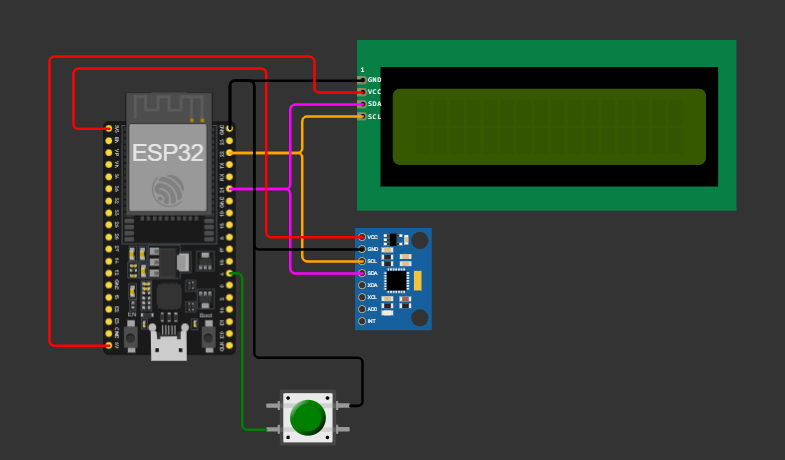

# Smart-Accident-Sentinel: Dual-Node IoT Vehicle Crash Detection & Telemetry Alert System

Smart-Accident-Sentinel is a distributed, cloud-integrated emergency telemetry and crash detection system engineered around the **ESP32 NodeMCU (ESP-WROOM-32)** and **ESP32-C3** RISC-V microcontrollers. The system operates across two dedicated hardware nodes: an in-vehicle impact sensing unit (**Node 1: CrashSense-Node**) and an in-cabin/desktop telemetry gateway (**Node 2: Telemetry-Gateway Node**). It pairs local 3D motion analysis, automated multi-network failover, acoustic-visual alarms, and instant dual-channel cloud telemetry (**Adafruit IO** and **Telegram Bot Service**).

---

## Academic & Course Context

- **Institution:** Gujarat Technological University (GTU)
- **Course:** Bachelor of Engineering (B.E.) in Electronics and Communication Engineering
- **Semester:** Semester 7
- **Subject:** Internet of Things (Subject Code: `3171108`)
- **Project Classification:** IoT Lab Mini Project (Experiment No. 13)
- **Target Course Outcomes:**
  - **CO-2:** Programming Embedded IoT Edge Devices
  - **CO-3:** Utilization of IoT Protocols (HTTP REST / Webhooks) for Cloud Telemetry
  - **CO-4:** End-to-End Distributed IoT System & Dashboard Design

---

## 4-Layer IoT Architecture

1. **Perception / Edge Layer:**
   - **Node 1 (CrashSense-Node):** MPU-6050 6-DoF IMU monitoring resultant 3D acceleration vector ($\vert{}\vert{}a\vert{}\vert{} \ge 1.5\text{G}$) and post-impact angular velocity stillness verification. Equipped with a $16\times2$ I2C LCD for local status feedback and an active-LOW button for captive provisioning.
   - **Node 2 (Telemetry-Gateway Node):** DHT22 sensor tracking cabin microclimate telemetry (temperature & humidity) and TTP223 capacitive touch sensor for emergency acknowledgment. Outputs alerts through a 128x64 SH1106 OLED display and an active piezo siren.

2. **Network Layer:**
   - Dual-mode Wi-Fi 802.11 b/g/n physical network layer. Node 1 includes automated RSSI-based auto-connect to up to 5 saved networks backed by ESP32 NVS storage, with fallback to an on-chip SoftAP captive portal (`192.168.4.1`).

3. **Application Protocol / Middleware Layer:**
   - **HTTP REST / Webhooks:** Encrypted HTTPS client dispatching REST POST payloads to the Adafruit IO cloud API.
   - **Telegram Bot API:** Instant cellular emergency messaging with timestamped Markdown alert dispatch and bidirectional `/reset` command polling.

4. **Cloud & Application Layer:**
   - **Adafruit IO Cloud Feed (`accident-status`):** Real-time cloud state synchronization (`1` = Critical Crash Latched, `0` = Dispatched / Standby).
   - **Telegram Emergency Channel:** Real-time push notifications sent directly to designated guardian devices with g-force intensity metrics and date/time stamps.

---

## System Hardware Interconnect & Schematics

### 1. Node 1 (CrashSense-Node)
<p align="center">
  
</p>

> **Vector Document:** Full vector PDF schematic is available in [`docs/Node 1 (CrashSense-Node) Schematic Connection Diagram.pdf`](docs/Node%201%20(CrashSense-Node)%20Schematic%20Connection%20Diagram.pdf).

#### Node 1 Simulation Model (Wokwi)
<p align="center">
  
</p>

---

### 2. Node 2 (Telemetry-Gateway Node)
<p align="center">
  
</p>

> **Vector Document:** Full vector PDF schematic is available in [`docs/Node 2 (Telemetry-Gateway Node) Schematic Connection Diagram.pdf`](docs/Node%202%20(Telemetry-Gateway%20Node)%20Schematic%20Connection%20Diagram.pdf).

#### Node 2 Simulation Model (Wokwi)
<p align="center">
  
</p>

---

## Hardware Pinout Matrix

### Node 1: CrashSense-Node (ESP32 NodeMCU 30-Pin DevKit)
| Component / Module | Module Pin | ESP32 Pin | Voltage Rail | Protocol / Type | Function Description |
| :--- | :--- | :--- | :--- | :--- | :--- |
| **MPU-6050 6-DoF IMU** | VCC | `3V3` | 3.3VDC | Power | Power supply to sensor core |
| | GND | `GND` | 0V | Ground | System reference ground |
| | SCL | `GPIO 22` | 3.3V Logic | I2C Clock | Hardware I2C Clock line |
| | SDA | `GPIO 21` | 3.3V Logic | I2C Data | Hardware I2C Data line (Address: `0x68`) |
| **16x2 Character LCD** | VCC | `VIN (5V)` | 5.0VDC | Power | Backlight and display power rail |
| | GND | `GND` | 0V | Ground | Power return |
| | SCL | `GPIO 22` | Shared Bus | I2C Clock | PCF8574 I2C Backpack Clock line |
| | SDA | `GPIO 21` | Shared Bus | I2C Data | PCF8574 I2C Backpack Data line (Address: `0x27`) |
| **Pushbutton (AP Force)** | Pin 1 | `GPIO 4` | 3.3V Logic | Digital In | Active-LOW button to launch SoftAP captive portal |
| | Pin 2 | `GND` | 0V | Ground | Pulled to ground upon button press |
| **Status Indicator LED** | Anode (+) | `GPIO 2` | 3.3V Logic | Digital Out | Visual blinking indicator for arming and alert latch |
| | Cathode (-) | `GND` (via 220Ω) | 0V | Ground | Current-limited ground return |

---

### Node 2: Telemetry-Gateway Node (ESP32-C3 SuperMini)
| Component / Module | Module Pin | ESP32-C3 Pin | Voltage Rail | Protocol / Type | Function Description |
| :--- | :--- | :--- | :--- | :--- | :--- |
| **SH1106 1.3" OLED** | VCC | `3V3` | 3.3VDC | Power | Display controller power rail |
| | GND | `GND` | 0V | Ground | Logic ground |
| | SCL | `GPIO 9` | 3.3V Logic | I2C Clock | Hardware Fast I2C Clock line |
| | SDA | `GPIO 8` | 3.3V Logic | I2C Data | Hardware Fast I2C Data line (Address: `0x3C`) |
| **DHT22 (AM2302)** | VCC | `3V3` | 3.3VDC | Power | Sensor supply voltage rail |
| | GND | `GND` | 0V | Ground | Sensor ground reference |
| | DATA | `GPIO 3` | 3.3V Logic | 1-Wire Digital | Digital temperature and relative humidity telemetry |
| **Active Piezo Siren** | Positive (+) | `GPIO 5` | 3.3V Logic | Digital Out | Pulse-modulated high-decibel acoustic alert |
| | Negative (-) | `GND` | 0V | Ground | Ground return |
| **TTP223 Capacitive Touch** | VCC | `3V3` | 3.3VDC | Power | Capacitive touch sensor power rail |
| | GND | `GND` | 0V | Ground | Sensor ground |
| | SIG (OUT) | `GPIO 7` | 3.3V Logic | Digital In | Active-HIGH input for 3s emergency ACK & silencing |

---

## Software & Library Requirements

Libraries listed in `libraries.txt`:
- `LiquidCrystal I2C` (by Frank de Brabander / Marco Schwartz)
- `Adafruit MPU6050`
- `Adafruit SH110X`
- `Adafruit GFX Library`
- `DHT sensor library`
- `Adafruit Unified Sensor`
- Built-in ESP32 core dependencies: `Wire`, `WiFi`, `WiFiClientSecure`, `HTTPClient`, `WebServer`, `Preferences`, `time.h`

---

## Project Structure

```text
Smart-Accident-Sentinel/
├── .gitignore
├── LICENSE
├── libraries.txt
├── Node 1 (CrashSense-Node) Schematic Connection Diagram.json
├── Node 2 (Telemetry-Gateway Node) Schematic Connection Diagram.json
├── README.md
├── src/
│   ├── CrashSense-Node.ino
│   └── Telemetry-Gateway-Node.ino
└── docs/
    ├── Node 1 (CrashSense-Node) Schematic Connection Diagram.pdf
    ├── Node 1 (CrashSense-Node) Schematic Connection Diagram.png
    ├── Node 2 (Telemetry-Gateway Node) Schematic Connection Diagram.pdf
    ├── Node 2 (Telemetry-Gateway Node) Schematic Connection Diagram.png
    ├── wokwi_simulation_CrashSense-Node.png
    └── wokwi_simulation_Telemetry-Gateway Node.png